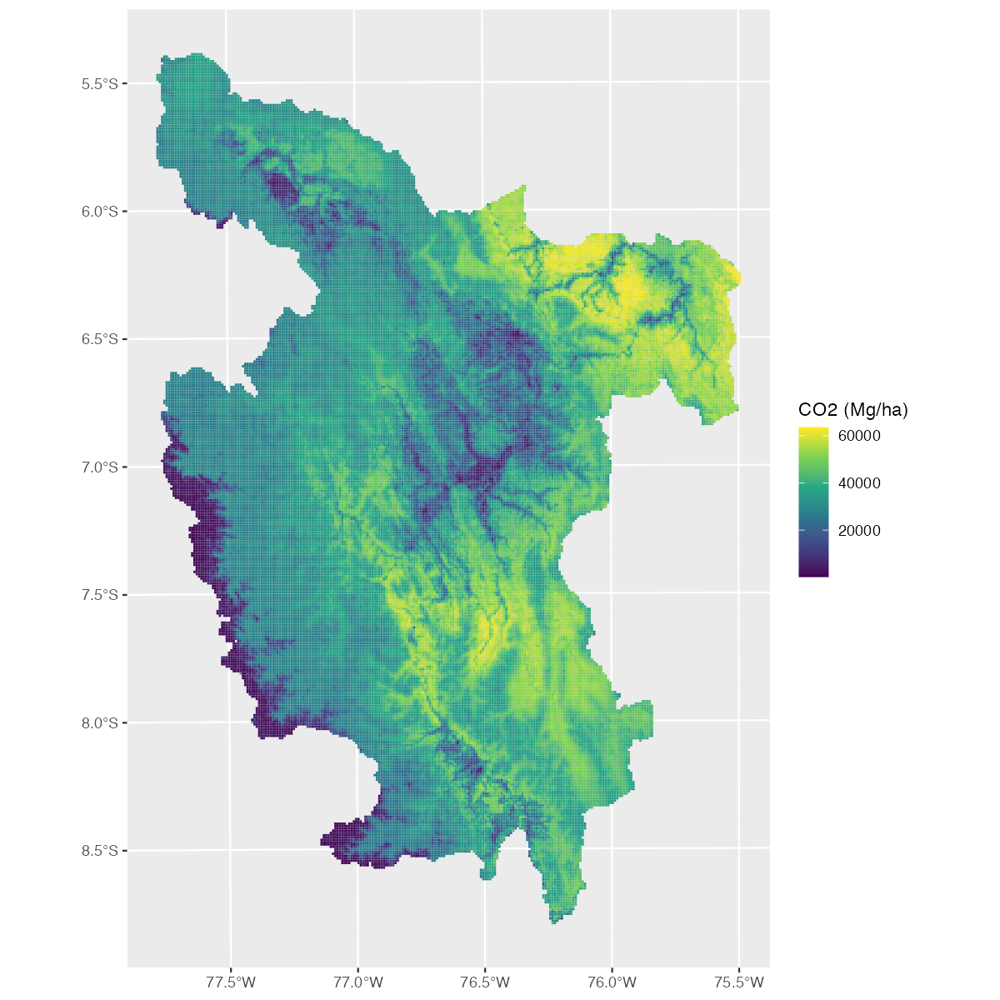

# Spatial analysis in R with `sf` and `exactextractr`

The following scripts present examples of how to use a selection of functions from the packages `sf` (Pebesma, 2018; Pebesma & Bivand, 2023) and `exactextractr` (Baston, n.d.). The study area is San Martín, Perú. The functions are applied to build a 1 km grid and to summarize aboveground biomass in each cell. Each script saves its results in the `data` folder.

## What each script does

| Script | What it shows |
|---|---|
| `0_gfw_key.R` | Creates the Global Forest Watch key with `httr`. Only needed for `2_biomass.R`. |
| `1_grid.R` | Builds a 1 km grid for San Martín with `st_make_grid` and clips it to the boundary. |
| `2_biomass.R` | Downloads aboveground biomass tiles and summarizes them for each cell with `exact_extract`. It gets the mean, median, min, max and standard deviation, the total per cell, and the carbon and CO2 stock. It also gives the share of low, medium and high biomass per cell. It also draws a map of the mean CO2 per cell with `ggplot2`. |

Run `1_grid.R` first. It saves the grid, and `2_biomass.R` reads it. This keeps the cell ids the same in the results.



## Functions covered

The scripts teach these functions from `sf` and `exactextractr`. Each row says which script has the example.

### sf

| Function | What it does | Script |
|---|---|---|
| `st_read` | Reads a spatial file into R | 1, 2 |
| `st_write` | Saves a spatial object as a file | 1 |
| `st_as_sf` | Turns an object into an sf object, a table with a geometry column | 1, 2 |
| `st_transform` | Changes the coordinate system | 1, 2 |
| `st_make_grid` | Builds square cells that cover the bounding box of an object | 1 |
| `grid[sm,]` | Keeps only the cells that touch the boundary | 1 |
| `st_make_valid` | Repairs shapes with errors | 2 |
| `st_bbox` | Gets the box that surrounds an object | 2 |
| `st_intersects` | Tells which shapes touch each other | 2 |
| `st_union` | Dissolves many shapes into one | 2 |

### exactextractr

| Function | What it does | Script |
|---|---|---|
| `exact_extract` | Summarizes raster values inside each polygon and counts partly covered pixels by their share | 2 |

The function has options that the scripts use. The option `fun` sets the summary operation, and `append_cols` keeps a column of the polygons, like the id, in the result.

These are the summary operations used in `fun`.

| Operation | What it gives |
|---|---|
| `mean` | The mean of the pixels that touch the cell, weighted by the share of each pixel inside the cell |
| `median` | The median, weighted in the same way |
| `min` and `max` | The smallest and the largest value of the pixels that touch the cell. They ignore the shares |
| `stdev` | The population standard deviation of the pixel values, weighted by the shares |
| `count` | The sum of the shares of all the pixels, so a partly covered pixel counts by its share |
| `frac` | The share of the covered area that each class of the raster occupies |

## Packages

The scripts load their packages with `pacman`.

```r
install.packages("pacman")
```

## Coordinate systems

The grid is built in UTM zone 18S (EPSG 32718). It measures in meters and keeps all cells the same size. The biomass tiles come in latitude and longitude, and the raster stays in latitude and longitude. The boundary and the grid are transformed to EPSG 4326 for the crop, the mask and `exact_extract`. The ids of the cells do not change, so the results match the grid.

## How the carbon stock is calculated

The biomass layer gives the aboveground live woody biomass density for the year 2000. The unit is megagrams of biomass per hectare (Mg/ha), at a resolution of about 30 m. The scripts turn it into a stock for each cell in four steps.

1. **Mean density per cell.** `exact_extract` gives the mean density of the pixels in each cell, weighted by the share of each pixel inside the cell.
2. **Total biomass per cell.** The mean density times the area of the cell in hectares. A 1 km cell has 100 ha, so the total is the mean times 100, in Mg of biomass. The scripts use the per hectare version of the layer. Density in Mg/ha times area in ha gives Mg, and every cell has the same known area.
3. **Carbon.** The total biomass times 0.47. This is the default carbon fraction for the aboveground biomass of tropical and subtropical forests in Table 4.3 of the IPCC (2006) guidelines, see the references.
4. **CO2.** The carbon times 44/12, the ratio of the molecular weights of CO2 and carbon.

Additional details:

- The result is a stock for the year 2000. It is not an emission, and it does not show what is lost.
- The data providers warn that single pixels have large uncertainty, and that biomass may be overestimated at low values and underestimated at high values. This is why the scripts use means over 1 km cells and not single pixels.
- The carbon fraction is a default. Some studies use 0.5, which would raise the carbon by about 6 percent. The number can be changed in `2_biomass.R`.
- The total uses the full 100 ha of the cell. It is exact only for cells fully inside San Martín, because the mask removes the pixels outside the boundary.

## Global Forest Watch key

`2_biomass.R` needs a free API key from Global Forest Watch. The script `0_gfw_key.R` makes it, following the guide of the Global Forest Watch Data API.

1. Run section 1 of `0_gfw_key.R` once. It signs up with a name and email.
2. Open the email, which may be in the spam folder, and set a password with the link. If the sign up is on the website instead, at https://www.globalforestwatch.org/my-gfw/, use the Sign up link. Do not log in with Google or Facebook, because then a password cannot be set.
3. Run section 2. It asks for the email and password, gets a token, and prints a key. The value called `api_key` is the key.
4. Add the key to `.Renviron` file as `GFW_KEY=your_key_here`. Section 2 opens the file. Then restart R and check it with `Sys.getenv("GFW_KEY")`.

The script runs in RStudio. It does not save the password or key in any file. The key expires after one year.

## Data sources

Global Administrative Areas. (2022). *GADM database of global administrative areas* (Version 4.1) [Data set]. https://gadm.org

Harris, N. L., Gibbs, D. A., Baccini, A., Birdsey, R. A., de Bruin, S., Farina, M., Fatoyinbo, L., Hansen, M. C., Herold, M., Houghton, R. A., Potapov, P. V., Requena Suarez, D., Roman-Cuesta, R. M., Saatchi, S. S., Slay, C. M., Turubanova, S. A., & Tyukavina, A. (2021). *Aboveground live woody biomass density (2000, 30 m, global)* [Data set]. Global Forest Watch. https://data-api.globalforestwatch.org/dataset/whrc_aboveground_woody_biomass_stock_2000

Harris, N. L., Gibbs, D. A., Baccini, A., Birdsey, R. A., de Bruin, S., Farina, M., Fatoyinbo, L., Hansen, M. C., Herold, M., Houghton, R. A., Potapov, P. V., Requena Suarez, D., Roman-Cuesta, R. M., Saatchi, S. S., Slay, C. M., Turubanova, S. A., & Tyukavina, A. (2021). Global maps of twenty-first century forest carbon fluxes. *Nature Climate Change, 11*(3), 234-240. https://doi.org/10.1038/s41558-020-00976-6

## References

Baston, D. (n.d.). *exactextractr: Fast extraction from raster datasets using polygons* (R package). https://github.com/isciences/exactextractr

Eggleston, H. S., Buendia, L., Miwa, K., Ngara, T., & Tanabe, K. (Eds.). (2006). *2006 IPCC guidelines for national greenhouse gas inventories: Volume 4. Agriculture, forestry and other land use*. Institute for Global Environmental Strategies.

Pebesma, E. (2018). Simple features for R: Standardized support for spatial vector data. *The R Journal, 10*(1), 439-446. https://doi.org/10.32614/RJ-2018-009

Pebesma, E., & Bivand, R. (2023). *Spatial data science: With applications in R*. Chapman and Hall/CRC. https://doi.org/10.1201/9780429459016

## Things to know

- The carbon and CO2 are stocks for the year 2000, and not emissions.
- The biomass data has a CC BY 4.0 license, so cite it when used.
- The biomass classes are low, medium and high. The limits are arbitrary, and can be changed in `2_biomass.R`.
- Download links can change. If one fails, open the source page and check the link.

## Folders

The scripts create their folders. Downloaded and saved data go in `data/` and are not uploaded to GitHub. The map goes in `graphs/`, which is uploaded, so the image in this README shows.
